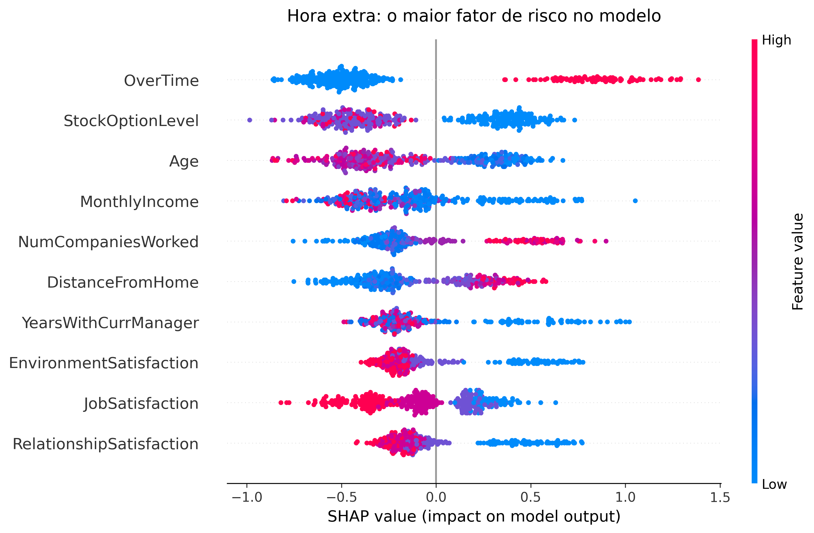

# Previsão de Rotatividade de Funcionários (HR Attrition) com SHAP

Projeto de Machine Learning desenvolvido durante o MBA, com o objetivo de prever quais funcionários têm maior chance de deixar a empresa e, principalmente, **entender por que o modelo toma essas decisões** usando SHAP.



## Sobre o projeto

A base é o conjunto de dados fictício **IBM HR Analytics Employee Attrition**, com 1.470 funcionários e dezenas de variáveis (idade, salário, hora extra, satisfação, tempo de casa, entre outras). A variável-alvo é `Attrition` (Yes/No), e cerca de 16% dos funcionários saíram, o que torna a base desbalanceada.

O notebook percorre as etapas abaixo.

1. Exploração dos dados e investigação de colunas sem valor preditivo
2. Pré-processamento (codificação de variáveis nominais e ordinais)
3. Árvore de Decisão, com poda, validação cruzada, tratamento de desbalanceamento e `GridSearchCV`
4. Ensemble, com Random Forest e XGBoost
5. Comparação dos modelos no mesmo conjunto de teste
6. Interpretabilidade com SHAP no modelo final (XGBoost ajustado)

## Resultados

Métricas no conjunto de teste, para a classe "saiu":

| Modelo | Acurácia | Precisão | Recall | F1 | ROC AUC |
|---|---|---|---|---|---|
| Árvore de Decisão (podada) | 0,734 | 0,318 | 0,576 | 0,410 | 0,685 |
| Random Forest (ajustado) | 0,842 | 0,556 | 0,085 | 0,147 | 0,762 |
| XGBoost (ajustado) | 0,826 | 0,456 | 0,441 | 0,448 | 0,754 |

Os Random Forests têm acurácia e AUC altas, mas recall muito baixo: quase não identificam quem vai sair. O **XGBoost ajustado** foi escolhido por ter o melhor equilíbrio entre recall e precisão (maior F1). É um modelo modesto, e o foco do projeto está em entender o que ele aprendeu.

## O que o SHAP mostrou

O SHAP mede o quanto cada variável empurrou a previsão do modelo, tanto no geral (summary plot) quanto para um funcionário específico (force plot).

- **Hora extra** (`OverTime`) é a variável de maior impacto: quem faz hora extra tem risco de saída bem maior segundo o modelo.
- **Nível de opções de ações, idade e salário mensal** mais altos reduzem o risco.
- **Mais empresas anteriores, maior distância de casa, pouco tempo com o gestor atual e satisfação baixa** aumentam o risco.

Em resumo, carga de trabalho e remuneração pesaram mais para o modelo do que cargo ou departamento.

## Ressalvas

- A base é **fictícia**, criada pela IBM para fins didáticos. Os resultados não representam nenhuma empresa real.
- O SHAP explica **o que o modelo aprendeu**, não relações de causa e efeito.

## Como rodar

1. Clone o repositório e entre na pasta.

```bash
git clone https://github.com/joaopedrodelcolli/hr-attrition-shap.git
cd hr-attrition-shap
```

2. Instale as dependências.

```bash
pip install -r requirements.txt
```

3. Deixe o arquivo `WA_Fn-UseC_-HR-Employee-Attrition.csv` na mesma pasta do notebook. Ele pode ser baixado no [Kaggle](https://www.kaggle.com/datasets/pavansubhasht/ibm-hr-analytics-attrition-dataset).

4. Abra e execute o notebook.

```bash
jupyter notebook HR_Attrition_Projeto_SHAP.ipynb
```

## Tecnologias

Python, pandas, scikit-learn, XGBoost, SHAP e matplotlib.

## Autor

João Pedro Del Colli — [LinkedIn](https://www.linkedin.com/in/joao-pedro-del-colli)
